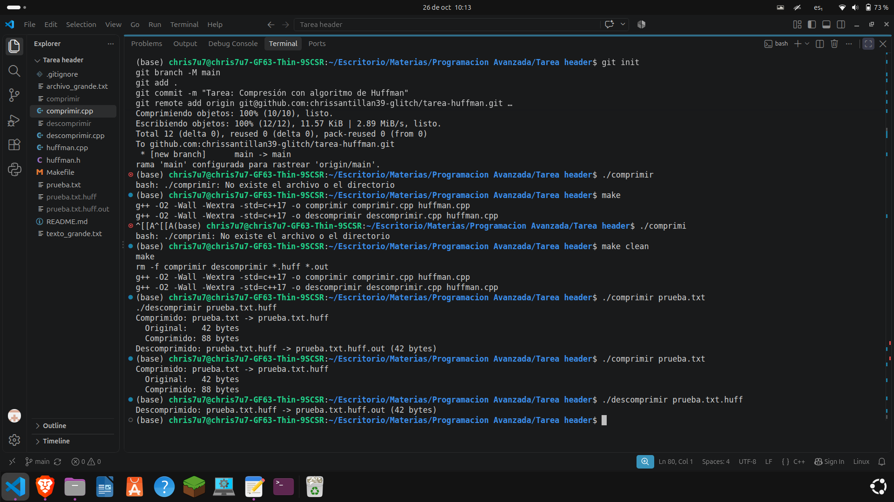

# Tarea: Compresión con Algoritmo de Huffman

Implementación en C++ del algoritmo de compresión de Huffman. 
El programa incluye un compresor y un descompresor de archivos de texto.

## Compilar
g++ -O2 -o comprimir comprimir.cpp huffman.cpp
g++ -O2 -o descomprimir descomprimir.cpp huffman.cpp

## Ejecutar
Para comprimir un archivo:
./comprimir archivo.txt

Para descomprimir:
./descomprimir archivo.txt.huff

## Demostración
Aquí se muestra el programa compilando y ejecutándose correctamente:

## Autor
Christopher Gómez - Programación Avanzada
